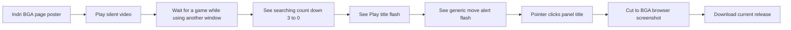
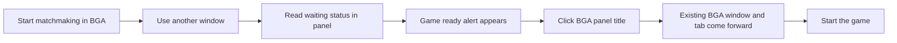

# BGA Title Tray video

## Goal

Show the everyday use case: Will can start matchmaking, switch to another window, and keep the BGA waiting status visible in the KDE panel instead of watching the browser tab. When a game is ready, the panel alerts him; clicking its title brings the existing BGA window and tab to the front, without hunting through windows and tabs. Use a short, silent, captioned video on the Indri product page. The panel frames came from version 0.4.7 on Will's desktop, while the 3 → 2 → 1 → 0 searching titles, Play alert, generic move alert, and pointer click are composited illustrations. The final frame uses Will's one-tab BGA browser screenshot. The sequence is not a recording of one live game. The edit holds each flash state for 0.5 seconds; the installed widget retains its 0.1-second flash timing.

## Storyboard

The frame is 1280 × 720, with Indri's dark surface, lime accent, readable cream captions, a captured KDE panel strip, and a final BGA browser frame. These screen mockups show the revised cut:

```text
0–3 s  ┌──────────────────────────────────────────────┐
       │ A game can start while you're elsewhere.    │
       │              [captured tray slides into view] │
       └──────────────────────────────────────────────┘

3–7 s ┌──────────────────────────────────────────────┐
       │ [BGA window]  ← [another window slides over] │
       │  3 → 2 → 1 → 0  SEARCHING                    │
       │ [captured tray remains visible at bottom]    │
       └──────────────────────────────────────────────┘

7–11s ┌──────────────────────────────────────────────┐
       │ GAME READY.                                  │
       │ [Play alert lands large, then flashes]       │
       └──────────────────────────────────────────────┘

11–15s┌──────────────────────────────────────────────┐
       │ [BGA behind another window]                  │
       │ [Play title stays visible in the tray]       │
       └──────────────────────────────────────────────┘

15–18s┌──────────────────────────────────────────────┐
       │ Your move.                                   │
       │ [generic move alert flashes in tray]         │
       └──────────────────────────────────────────────┘

18–22s┌──────────────────────────────────────────────┐
       │ [pointer clicks tray title]                  │
       │ [Will's one-tab BGA screenshot comes forward] │
       └──────────────────────────────────────────────┘
```

## Viewer flow

```text
Product page
┌───────────────────────────────────────────────────────┐
│ Video poster: Play title on real panel                 │
│ Large centered Play button                             │
│ Silent demo · illustrative title sequence             │
│ Brief note: captured panel, composited titles         │
└───────────────────────────────────────────────────────┘
       │ click Play
       ▼
Muted inline playback fades in → controls → product details → download link
```



## Production and checks

- [x] Capture the installed panel's normal and white flash frames without including desktop content in the published sources.
- [x] Build an H.264 MP4 and poster with a readable alert sequence.
- [x] Inspect frames at the start, flash, and end; verify captions and absence of private desktop content.
- [x] Add the video and a text description to the Indri product page.
- [x] Preview desktop and mobile layout, build, publish, and verify the live asset.

Will found the original 0.1-second video flashing too fast. The video edit now holds each frame for 0.5 seconds; the installed app is unchanged. Indri v0.1.219 serves the revised MP4, whose SHA-256 matches the local build (`138c67f3390f49c9a7e1eed4cf5c31ca79a83f28e3467d586409c21681e580c6`).

Will also rejected the “No separate tray icon” line: it distracted from the point of an app that lives beside the tray. Indri v0.1.220 replaces it with “No window or tab hunting.” The live MP4 matches the revised build (`05648648f6f1792399d56fbfd1d7de289e4288740aeb762f08f30e9fb00a62ff`).

## Queue and move-alert revision

Will pointed out that a flashing “Searching for 3 player(s)” title falsely suggests matchmaking itself is the alert. The revised edit shows searching count down 3 → 2 → 1 → 0 without flashing, then flashes “Play • Board Game Arena.” The closing “Stay in the game” frame flashes the generic illustrative title “You must make your move • Board Game Arena.” The real panel frames remain, with those titles composited and disclosed in the captions and transcript.

- [x] Build the countdown and both alert sequences; inspect white and normal frames for each.
- [x] Update the poster, transcript, and site video; publish and verify the live assets.

Indri v0.1.221 serves the countdown and two alert sequences. The live MP4 matches the local build by SHA-256 (`8bf23e2589b4bddd85b31dba7594baf6b3c30f364055ebb51309e751df1086dc`).

## Blender motion pass

The motion layer uses [Blender 5.0.1 keyframes](https://docs.blender.org/manual/en/5.0/animation/introduction.html) and a transparent VP9 export. The existing [FFmpeg filter build](https://ffmpeg.org/ffmpeg-filters.html) composites it over the captured panel frames and illustrative titles. The accents follow state changes and leave the panel text readable:

| Time | Motion cue |
|---|---|
| 0–3 s | Draw a lime underline below the opening copy. |
| 3–6 s | Fill a queue progress line in four steps alongside the 3 → 2 → 1 → 0 title changes. |
| 6–10 s | Draw lime corner brackets around the flashing Play panel. |
| 14–18 s | Hold the move alert and closing URL steady enough to read. |
| 18–22 s | Expand a ring from the pointer click, then draw a thin accent above the BGA browser frame. |

- [x] Prototype the Blender motion pass and export frames for the existing FFmpeg build.
- [x] Inspect motion at desktop and 390 px mobile player sizes before replacing the published cut.

The 22-second motion cut keeps the large captions readable at both sizes. The Blender source is `media/promo/render_motion.py`; `render-motion.sh` exports the transparent VP9 layer, and `build.sh` composites it with the panel and browser frames.

Indri [`v0.1.224`](https://github.com/wbniv/indri.studio/tree/v0.1.224) serves the motion cut. The live MP4 matches the local build by SHA-256 (`410a5cc77f4f51a599f7263557897a96c6346478134b58d8a646abf2f33a9052`).

## Motion redesign after review

Will rejected the Blender accents as too slight to sell the app. [Google Design's motion guidance](https://design.google/library/making-motion-meaningful) emphasizes moving shared elements to guide attention through a state change. The new edit animates the actual story elements, rather than drawing extra decoration over a mostly still video:

| Scene | Movement that explains the feature |
|---|---|
| Opening | The captured tray slides into view beneath the headline. |
| Waiting | An illustrative second window covers the BGA window while the tray remains visible; a large 3 → 2 → 1 → 0 count changes with the tray title. |
| Ready | The Play tray lands at hero scale, settles, and flashes at the video’s readable 0.5-second pace. |
| In game | The foreground window remains while the tray changes to a flashing generic move alert. |
| Return | A pointer clicks the tray; Will’s BGA screenshot moves from the background to fill the frame. |

The animated window cards are abstract illustrations, not captured BGA or desktop UI. `render_video.py` draws the 1280 × 720 frames with Pillow and feeds them to FFmpeg; `build.sh` creates the MP4 and poster. This replaces the earlier Blender overlay.

- [x] Research motion design references and sketch the new visual sequence.
- [x] Render and inspect the full revised cut at desktop and 390 px mobile player sizes.
- [ ] Publish and verify the live video and poster.

## Click-to-focus edit

The updated video shows a composited pointer click on the panel title, then brings Will's one-tab BGA browser screenshot to the foreground. The browser frame illustrates the focus result; it is not a continuous live recording of the click. The screenshot is cropped to remove the desktop panel and unrelated notification.

```text
Panel alert and composited click      Browser screenshot after the cut
┌────────────────────────────┐       ┌────────────────────────────┐
│ You must make your move     │       │ One BGA tab in Chrome      │
│ [pointer → panel title]     │       │ BGA welcome page          │
├────────────────────────────┤ click ├────────────────────────────┤
│ KDE panel strip            │ ────▶ │ Browser viewport           │
└────────────────────────────┘       └────────────────────────────┘
```



- [x] Receive Will's one-tab BGA browser screenshot and crop unrelated desktop content.
- [x] Compose a pointer click at the end and cut to the BGA browser frame.
- [x] Verify the new video and poster, then update and publish the product page.

Indri v0.1.222 serves the 22-second cut. The deploy workflow passed, desktop and 390 px page previews showed the centered Play control, and the live MP4 matches the local source by SHA-256 (`47ea0947a5c35930bb52dfcc96bda71fc6e67bfc502a00ec20fa55d164ae878d`).

## Product page cleanup

Will asked to remove the expandable video transcript. The short caption under the player still identifies the panel frames and composited titles.

- [x] Remove the transcript block and its unused styling from the product page.
- [x] Publish the updated page and verify that the live transcript is gone.

Indri v0.1.223 is live. The published page retains the video player and short caption, and contains no transcript block.

AI assistance: Codex CLI 0.163.0, GPT-6; reasoning-effort metadata unavailable in this session.
