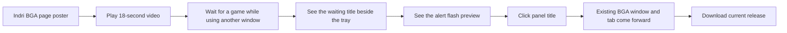
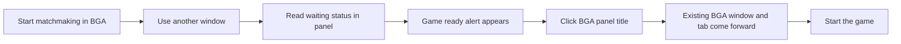

# BGA Title Tray video

## Goal

Show the everyday use case: Will can start matchmaking, switch to another window, and keep the BGA waiting status visible in the KDE panel instead of watching the browser tab. When a game is ready, the panel alerts him; clicking its title brings the existing BGA window and tab to the front, without hunting through windows and tabs. Use a short, silent, captioned video on the Indri product page. The current flash frames came from a manual preview captured from version 0.4.7 on Will's desktop; they are not a recorded game start. Only a cropped panel strip enters the published flash sequence. The edit holds each flash state for 0.5 seconds for readability; the installed widget retains its 0.1-second flash timing.

## Storyboard

The frame is 1280 × 720, with Indri's dark surface, lime accent, readable cream captions, and a captured KDE panel strip. These are screen mockups for the planned five shots:

```text
0–3 s  ┌──────────────────────────────────────────────┐
       │ INDRI  /  BOARD GAME ARENA TITLE TRAY        │
       │                                              │
       │ Waiting for a game? Keep doing your thing.  │
       │ BGA stays visible beside the system tray.    │
       └──────────────────────────────────────────────┘

3–6 s ┌──────────────────────────────────────────────┐
       │ Watch the queue without watching the tab.   │
       │ [other window in front]                      │
       │ [panel: Searching for 3 player(s)…]          │
       └──────────────────────────────────────────────┘

6–10s ┌──────────────────────────────────────────────┐
       │ A game alert you can notice.                 │
       │ Manual preview; slowed for clarity.          │
       │   [actual captured normal / white frames]    │
       └──────────────────────────────────────────────┘

10–14s┌──────────────────────────────────────────────┐
       │ One click brings BGA to you.                 │
       │ [other window in front]                      │
       │ [panel title] ← pointer clicks               │
       │       ↓ existing BGA window and tab appear   │
       └──────────────────────────────────────────────┘

14–18s┌──────────────────────────────────────────────┐
       │ Stay in the game.                            │
       │ No window or tab hunting.                    │
       │ Linux · KDE Plasma 6 · Chrome / Chromium      │
       └──────────────────────────────────────────────┘
```

## Viewer flow

```text
Product page
┌───────────────────────────────────────────────────────┐
│ Video poster: real white-flash panel + Play 18-second │
│ demo button                                           │
│ 18-second silent demo · real panel preview            │
│ ▸ Video transcript                                    │
└───────────────────────────────────────────────────────┘
       │ click Play
       ▼
Inline player with controls → transcript → download link
```



## Production and checks

- [x] Capture the installed panel's normal and white flash frames without including desktop content in the published sources.
- [x] Build an 18-second H.264 MP4 and poster, with the preview and slower pacing identified on screen.
- [x] Inspect frames at the start, flash, and end; verify captions and absence of private desktop content.
- [x] Add the video and a text description to the Indri product page.
- [x] Preview desktop and mobile layout, build, publish, and verify the live asset.

Will found the original 0.1-second video flashing too fast. The video edit now holds each frame for 0.5 seconds; the installed app is unchanged. Indri v0.1.219 serves the revised MP4, whose SHA-256 matches the local build (`138c67f3390f49c9a7e1eed4cf5c31ca79a83f28e3467d586409c21681e580c6`).

Will also rejected the “No separate tray icon” line: it distracted from the point of an app that lives beside the tray. Indri v0.1.220 replaces it with “No window or tab hunting.” The live MP4 matches the revised build (`05648648f6f1792399d56fbfd1d7de289e4288740aeb762f08f30e9fb00a62ff`).

## Next edit: waiting, alert, and click-to-focus

The current video shows a captured “Searching for 3 player(s)” title, but does not explain why seeing the queue in the panel is useful. It also says “One click takes you back” while leaving the panel still. Open the next cut with Will waiting for a game while another window is in front. Keep the waiting title visible in the panel, show the alert, then record one click on the panel title bringing the existing BGA window and tab forward. Close on the download call to action. Keep the panel title as the click target. The current flash sequence is a manual preview, so label it as such unless a real game-start alert is captured. Crop or mask unrelated desktop content before publication, and avoid showing private BGA details.

```text
Waiting in another window            After the alert and click
┌────────────────────────────┐       ┌────────────────────────────┐
│ Other window in front      │       │ Existing BGA tab          │
│ Work continues             │       │ Game is ready             │
├────────────────────────────┤ click ├────────────────────────────┤
│ [Searching for players…]   │ ────▶ │ [BGA panel title]          │
└────────────────────────────┘       └────────────────────────────┘
```



- [ ] Capture the waiting status with another window in front, plus the click and resulting focus change from the installed release.
- [ ] Capture a real game-start alert if available; otherwise keep the manual preview clearly identified.
- [ ] Edit the waiting and click footage into the 3–6-second and 10–14-second shots; keep the existing tab visible and the sequence legible without audio.
- [ ] Verify the new video and poster, then update and publish the product page.

AI assistance: Codex CLI 0.163.0, GPT-6; reasoning-effort metadata unavailable in this session.
