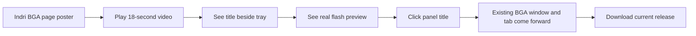
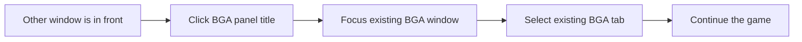

# BGA Title Tray video

## Goal

Show the motion that a still image cannot: the installed KDE panel title flashes in place and returns to its normal state. Then show its second useful action: clicking the panel title brings the existing BGA window and tab to the front, so Will does not have to search through windows and tabs. Use a short, silent, captioned video on the Indri product page. The flash frames came from a manual preview captured from version 0.4.7 on Will's desktop; they are not a recorded game offer. Only a cropped panel strip enters the published flash sequence. The edit holds each flash state for 0.5 seconds for readability; the installed widget retains its 0.1-second flash timing.

## Storyboard

The frame is 1280 × 720, with Indri's dark surface, lime accent, readable cream captions, and a captured KDE panel strip. These are screen mockups for the planned five shots:

```text
0–3 s  ┌──────────────────────────────────────────────┐
       │ INDRI  /  BOARD GAME ARENA TITLE TRAY        │
       │                                              │
       │ Never miss your next move.                   │
       │ A small KDE panel companion for BGA.         │
       └──────────────────────────────────────────────┘

3–6 s ┌──────────────────────────────────────────────┐
       │ Your game stays in sight.                    │
       │ The tab title lives beside the system tray.  │
       │   [actual captured panel: normal frame]      │
       └──────────────────────────────────────────────┘

6–10s ┌──────────────────────────────────────────────┐
       │ An alert you can actually notice.            │
       │ Real frames; flash slowed for clarity.       │
       │   [actual captured normal / white frames]    │
       └──────────────────────────────────────────────┘

10–14s┌──────────────────────────────────────────────┐
       │ One click brings BGA to you.                 │
       │ [other window in front]                      │
       │ [panel title] ← pointer clicks               │
       │       ↓ existing BGA window and tab appear   │
       └──────────────────────────────────────────────┘

14–18s┌──────────────────────────────────────────────┐
       │ Stay in the game.                            │
       │ No tab hunting. No separate tray icon.       │
       │ Linux · KDE Plasma 6 · Chrome / Chromium      │
       └──────────────────────────────────────────────┘
```

## Viewer flow

```text
Product page
┌───────────────────────────────────────────────────────┐
│ Video poster: real white-flash panel + Play 18-second │
│ demo button                                           │
│ 18-second silent demo · real panel preview            │
│ ▸ Video transcript                                    │
└───────────────────────────────────────────────────────┘
       │ click Play
       ▼
Inline player with controls → transcript → download link
```



## Production and checks

- [x] Capture the installed panel's normal and white flash frames without including desktop content in the published sources.
- [x] Build an 18-second H.264 MP4 and poster, with the preview and slower pacing identified on screen.
- [x] Inspect frames at the start, flash, and end; verify captions and absence of private desktop content.
- [x] Add the video and a text description to the Indri product page.
- [x] Preview desktop and mobile layout, build, publish, and verify the live asset.

Will found the original 0.1-second video flashing too fast. The video edit now holds each frame for 0.5 seconds; the installed app is unchanged. Indri v0.1.219 serves the revised MP4, whose SHA-256 matches the local build (`138c67f3390f49c9a7e1eed4cf5c31ca79a83f28e3467d586409c21681e580c6`).

## Next edit: show the click-to-focus feature

The current video says “One click takes you back” but leaves the panel still. Replace that portion with a real screen recording of one click on the panel title while another window is in front. Show the existing BGA window and tab becoming active, then close on the download call to action. Keep the panel title as the click target; version 0.4.7 has no separate tray icon or desktop notification. Crop or mask unrelated desktop content before publication, and avoid showing private BGA details.

```text
Before click                         After click
┌────────────────────────────┐       ┌────────────────────────────┐
│ Other window in front      │       │ Existing BGA tab          │
│                            │       │ Your game is ready        │
├────────────────────────────┤ click ├────────────────────────────┤
│ [BGA panel title] ← pointer│ ────▶ │ [BGA panel title]          │
└────────────────────────────┘       └────────────────────────────┘
```



- [ ] Capture the click and resulting focus change from the installed release.
- [ ] Edit the footage into the 10–14-second shot; keep the existing tab visible and the sequence legible without audio.
- [ ] Verify the new video and poster, then update and publish the product page.

AI assistance: Codex CLI 0.163.0, GPT-6; reasoning-effort metadata unavailable in this session.
