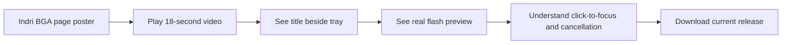

# BGA Title Tray video

## Goal

Show the motion that a still image cannot: the installed KDE panel title flashes in place and returns to its normal state. Use a short, silent, captioned video on the Indri product page. The footage is a manual flash preview captured from version 0.4.7 on Will's desktop; it is not a recorded game offer. Only a cropped panel strip enters the published video.

## Storyboard

The frame is 1280 × 720, with Indri's dark surface, lime accent, readable cream captions, and a captured KDE panel strip. These are screen mockups for the four shots:

```text
0–3 s  ┌──────────────────────────────────────────────┐
       │ INDRI  /  BOARD GAME ARENA TITLE TRAY        │
       │                                              │
       │ Never miss your next move.                   │
       │ A small KDE panel companion for BGA.         │
       └──────────────────────────────────────────────┘

3–6 s ┌──────────────────────────────────────────────┐
       │ Your game stays in sight.                    │
       │ The tab title lives beside the system tray.  │
       │   [actual captured panel: normal frame]      │
       └──────────────────────────────────────────────┘

6–10s ┌──────────────────────────────────────────────┐
       │ An alert you can actually notice.            │
       │ Actual panel, manual flash preview.          │
       │   [actual captured normal / white frames]    │
       └──────────────────────────────────────────────┘

10–18s┌──────────────────────────────────────────────┐
       │ One click takes you back.                    │
       │ No extra tab. No separate tray icon.         │
       │   [actual captured panel: normal frame]      │
       │ Linux · KDE Plasma 6 · Chrome / Chromium      │
       └──────────────────────────────────────────────┘
```

## Viewer flow

```text
Product page
┌───────────────────────────────────────────────────────┐
│ Video poster: real white-flash panel + Play 18-second │
│ demo button                                           │
│ 18-second silent demo · real panel preview            │
│ ▸ Video transcript                                    │
└───────────────────────────────────────────────────────┘
       │ click Play
       ▼
Inline player with controls → transcript → download link
```



## Production and checks

- [x] Capture the installed panel's normal and white flash frames without including desktop content in the published sources.
- [x] Build an 18-second H.264 MP4 and poster, with the preview identified on screen.
- [x] Inspect frames at the start, flash, and end; verify captions and absence of private desktop content.
- [x] Add the video and a text description to the Indri product page.
- [ ] Preview desktop and mobile layout, build, publish, and verify the live asset.

AI assistance: Codex CLI 0.163.0, GPT-6; reasoning-effort metadata unavailable in this session.
