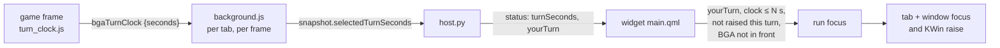
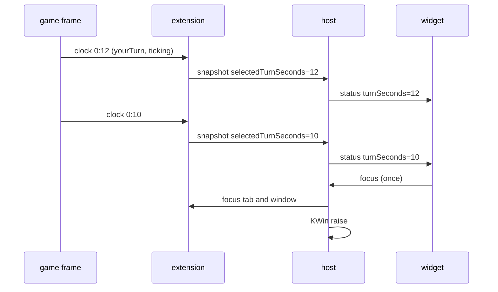
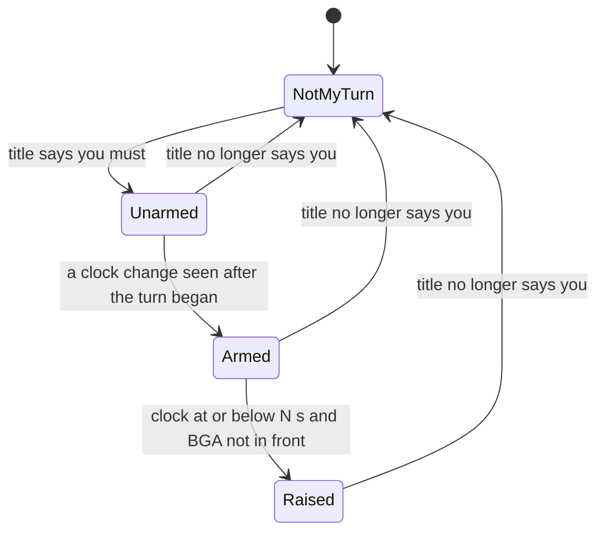
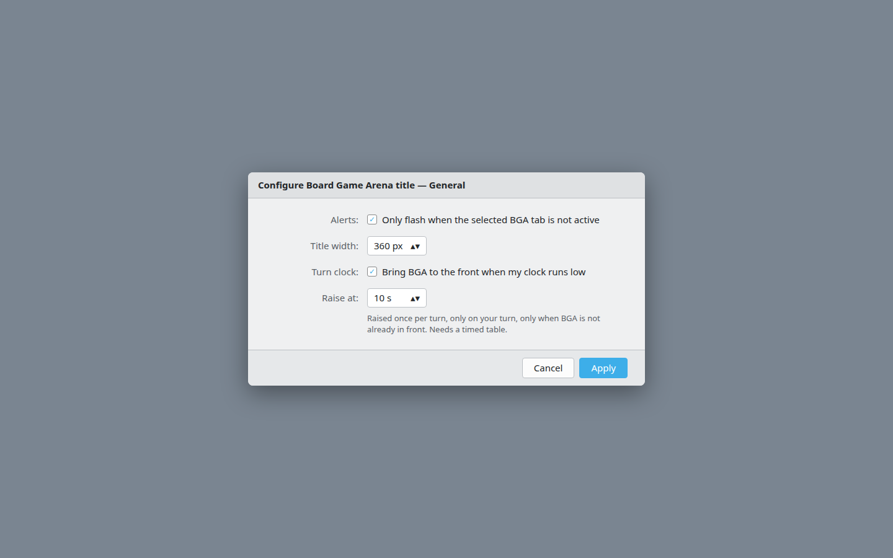

# Raise BGA when my turn clock runs low

Will asked (2026‑10‑25) for the tray to force Board Game Arena to the front when 10 s or less remain on his turn clock.

## Evidence

A live Catan table, read from DevTools on 2026‑10‑25. The game runs in an iframe (`https://boardgamearena.com/17/catan?table=…`), not in the top document, so the existing content script (top frame only) cannot see it. The player's own clock:

```html
<div id="overall_player_board_92969189" class="player-board current-player-board">
  … <span id="timeToThink_92969189" class="timeToThink">3:27</span>
```

The other boards carry `player-board` without `current-player-board`. Selector: `.player-board.current-player-board .timeToThink`.

## Flow



## Sequence



## State: one turn



*Unarmed* exists because the title can flip to "you must" before the clock span updates, and the span then still shows last turn's low reading. A reading only counts once it has changed after the turn began.

## Rules

- Fires only when the title says it is my turn (`you` in the first title segment, see `f5112e8`), the clock reads ≤ the threshold, and BGA is not already in front.
- Once per turn. If I move away after the raise it does not raise again; the next turn re‑arms it.
- A negative reading (`-0:05`, overtime) counts as ≤ threshold.
- No clock element (an untimed table) means no value, so nothing fires.
- Setting on by default, threshold 10 s, both in the widget's General settings.
- The host extrapolates between readings (reading minus elapsed time) so a late page update does not delay the raise.

## Mockup

[](2026-10-25-turn-clock-raise/settings.html)

The raise itself has no new surface: it is the existing click-to-focus path.

## Verification

1. `python3 -m pytest -q` and `node tests/test_turn_clock.js` pass.
2. On a timed Catan table, on my turn with BGA behind another window, the window comes forward at ≤ 10 s, once.
3. Leave the BGA tab hidden for over 5 minutes on a timed turn, then compare the displayed clock with a stopwatch. Chrome throttles hidden‑tab timers after 5 minutes; if the page's clock falls behind, the raise comes late and the extrapolation needs to anchor differently.
4. Untimed table: no raise.
